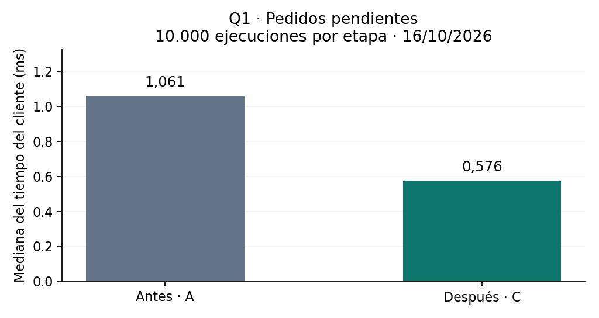
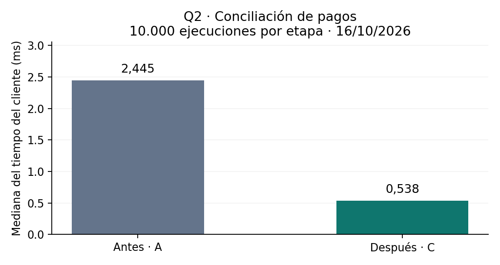
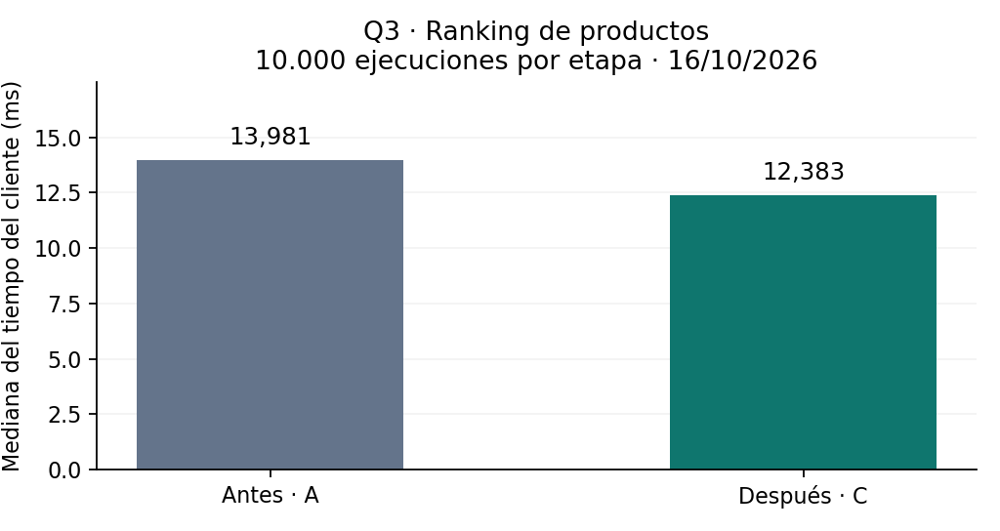
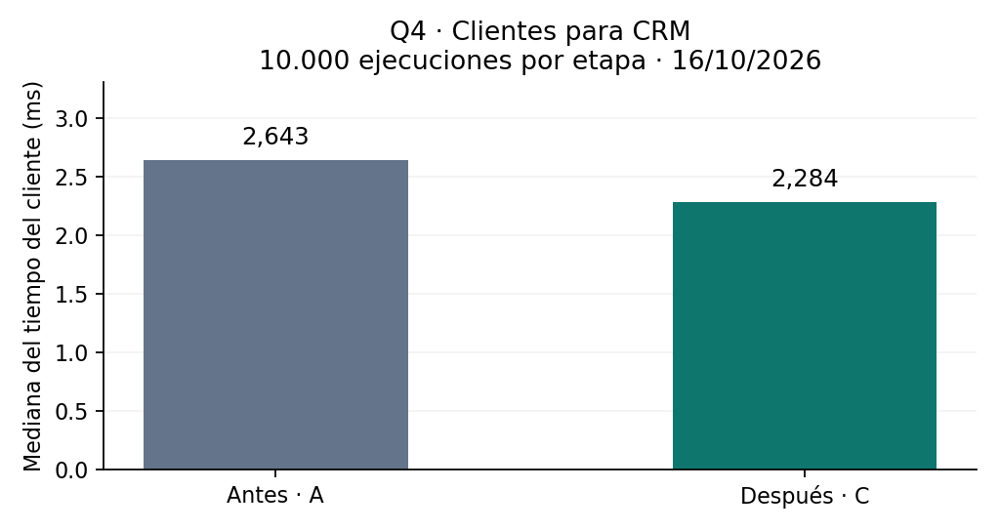
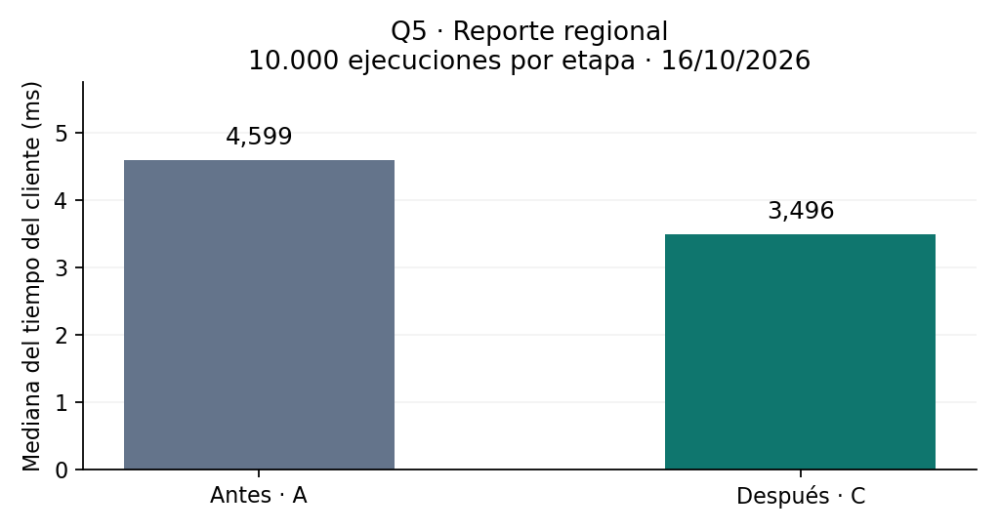

# Informe Final — Optimización de Consultas de Negocio

Actividad 2.4 / EP2. El informe documenta las decisiones de ajuste y sus resultados siguiendo el criterio **evidencia → causa → efecto**.

## Datos del estudiante

| Campo | Valor |
|---|---|
| Nombre y apellido / integrantes | **Por completar** |
| Sección / jornada | **Por completar** |
| Motor y versión | MySQL 8.0.46-0ubuntu0.24.04.4, InnoDB |
| Entorno y herramientas | MySQL local sobre WSL2; Python 3.13.5, mysql-connector-python y pidstat |
| Fecha de medición | 16 de octubre de 2026, 22:06–22:24, hora de Chile |
| Fecha de entrega | **Por completar** |

## Checklist de entrega

- [x] Se incluyen cinco consultas con SQL original y optimizado exactos, dentro de su sección.
- [x] Cada consulta contiene evidencia ANTES y DESPUÉS: salida completa de EXPLAIN ANALYZE y métricas de tiempo y trabajo del motor.
- [x] Cada consulta incluye tabla A/B/C y tabla Antes/Después con diferencia y porcentaje.
- [x] Cada consulta incluye un gráfico simple de barras Antes/Después, consistente con sus métricas.
- [x] Cada consulta tiene una interpretación que conecta evidencia, causa y efecto.
- [x] Se presentan conclusiones finales y trade-offs/limitaciones, tanto por consulta como del experimento.
- [ ] Se incorpora la cápsula audiovisual de 2–3 minutos y se comprueba su acceso: **pendiente; aún no se dispone de un enlace verificable**. Se incluye su guion en la sección 8.

Este checklist refleja lo efectivamente disponible. La cápsula, los datos personales y la fecha de entrega no se dan por completados.

## 1. Resumen ejecutivo

El trabajo estudia cinco necesidades de una cadena comercial: preparar pedidos, revisar pagos, analizar demanda, seleccionar clientes y evaluar sucursales. El objetivo es entregar la misma información con menos trabajo del servidor, sin alterar las reglas del negocio. Cada consulta se evaluó de manera independiente mediante una reescritura y un índice específico, contra su propia línea base. Por ejemplo, la bandeja de pedidos pasó de 1,061 a 0,576 ms de mediana y eliminó el ordenamiento intermedio, conservando sus 50 resultados. También se documentan intervenciones que no aceleraron por sí solas y diferencias entre pruebas cortas y sostenidas. El valor comercial potencial está en reducir procesamiento repetido y acompañar el crecimiento del uso; no se demostró todavía un ahorro económico ni una mejora productiva de atención.

## 2. Contexto y descripción de la base de datos

La base `ep2_lab` representa una cadena de comercios. Cada pedido pertenece a un cliente y una sucursal; sus ítems identifican productos y cantidades, y sus pagos se registran por separado.

| Tabla | Filas comprobadas | Información representada |
|---|---:|---|
| `ep2_stores` | 20 | Sucursales y regiones |
| `ep2_customers` | 5.000 | Clientes, ciudad y segmento |
| `ep2_products` | 2.000 | Catálogo de productos |
| `ep2_orders` | 20.000 | Pedidos, estado, fecha y monto |
| `ep2_order_items` | 100.000 | Productos y unidades por pedido |
| `ep2_payments` | 15.000 | Pagos, medio, fecha y monto |

La instalación parte de `dataset.sql`. Los conteos provienen de la lectura completa de las tablas y sus huellas SHA-256 coinciden antes y después de la suite: [dataset inicial](evidencias/entorno/dataset_before.json), [dataset final](evidencias/entorno/dataset_after.json) y [verificación](evidencias/entorno/dataset_equivalence.json).

Los datos son sintéticos. Un pedido `PAID` no necesariamente tiene un pago asociado, y los pagos no siempre concuerdan con el estado del pedido. Se distinguen, por tanto, pagos registrados, pedidos marcados `PAID` y valor de pedidos no cancelados. No se infieren margen, inventario disponible ni ingresos bancarios liquidados.

## 3. Problema de rendimiento y objetivo

Las consultas se seleccionaron por decisiones concretas del comercio y por señales técnicas observables: recorrer registros que luego se descartan, ordenar antes de aplicar un límite, contar cuando basta verificar existencia y recuperar filas completas para obtener importes. No se documentó una lentitud productiva ni reclamos de usuarios; los tiempos iniciales ya eran de milisegundos en un laboratorio pequeño.

El objetivo de cada experimento es preservar el resultado y comprobar si disminuyen latencia o trabajo lógico. Su valor para el negocio puede aparecer al repetir una operación o aumentar su volumen, pero ese efecto requiere medir la frecuencia y la carga reales. Cada sección 5.1–5.5 explica su propia necesidad, SQL, diagnóstico, intervenciones, evidencia y conclusión; no se comparan necesidades comerciales entre sí.

## 4. Metodología de medición

Se utilizó MySQL local en WSL2, con CPU identificada como Intel Core Ultra 7 165H, 22 CPU lógicas visibles, 15,34 GiB de RAM y buffer pool InnoDB de 128 MiB. El almacenamiento aparece como disco virtual; no se confirmó el tipo físico del equipo. Fuentes: [CPU](evidencias/entorno/host_cpu.txt), [RAM](evidencias/entorno/host_ram.txt), [versión](evidencias/entorno/mysql_version.csv) y [configuración](evidencias/entorno/mysql_variables.csv).

| Etapa | Configuración | Efecto estudiado |
|---|---|---|
| A | SQL original e índices de origen | Línea base de esa consulta |
| B | SQL reescrito, sin índice experimental | Efecto de la reescritura A→B |
| C | Exactamente el SQL de B, con su índice experimental | Efecto incremental del índice B→C |

Cada etapa tuvo dos calentamientos, 30 ejecuciones cortas y 10.000 sostenidas, en una conexión por lote y con un cliente secuencial. Hubo pausas de 10 segundos antes de cada lote. Los índices se crearon individualmente y se retiraron después de C; los inventarios verifican la restauración de los índices de origen. No se ejecutó `ANALYZE TABLE` adicional en esta suite. Los parámetros congelados se repiten en cada consulta.

Python midió `execute` y recepción completa de filas. La mediana representa el valor central; la media, el promedio; p95 usa el rango más próximo. `EXPLAIN ANALYZE` se ejecutó aparte: sus filas y ciclos son reales, pero su tiempo instrumentado no sustituye el benchmark normal. Los costos estimados del plan no son milisegundos.

CPU, RSS e I/O corresponden al proceso MySQL completo durante el lote y pueden incluir otras sesiones. Se muestrearon cada segundo, excluyendo DDL y calentamientos. Los contadores de sesión son deltas del bloque y no representan páginas físicas. Se conserva la misma cantidad de operaciones por etapa para comparar CPU acumulada.

En las tablas, **reducción = A − C** y **mejora = (A − C) / A × 100**, calculadas antes de redondear. Los tiempos usan tres decimales; los porcentajes, dos. Las tablas principales corresponden a 10.000 ejecuciones y cada conclusión contrasta la muestra corta. La equivalencia se comprobó mediante CSV y checksum tipado; la suite terminó correctamente y se verificó la integridad de 951 archivos del manifiesto. Fuentes: [ejecución](evidencias/ejecucion.json) y [manifiesto](evidencias/integridad_sha256.csv).

## 5. Análisis de las consultas

### 5.1 Consulta Q1 — Últimos pedidos pendientes de una sucursal

#### Propósito de negocio y razón de selección

El personal necesita identificar los últimos 50 pedidos `CREATED` de su sucursal para preparar el trabajo. Se eligió porque una bandeja que se abre repetidamente debería localizar directamente los pedidos relevantes. El orden es fecha e identificador descendentes; el límite no representa el total de pendientes.

#### SQL exacto original y parámetros

```sql
SET @store_id := 15;
SET @long_start_ts := '2026-07-16 00:00:00';
SET @end_ts := '2026-10-14 00:00:00';

SELECT o.order_id, o.customer_id, o.order_ts, o.total_amount
FROM ep2_orders o
WHERE o.store_id=@store_id AND o.status='CREATED'
  AND DATE(o.order_ts)>=DATE(@long_start_ts)
  AND DATE(o.order_ts)<DATE(@end_ts)
ORDER BY o.order_ts DESC, o.order_id DESC
LIMIT 50;
```

#### Evidencia ANTES y diagnóstico

Salida real de `EXPLAIN ANALYZE` en A:

```text
-> Limit: 50 row(s)  (cost=82.7 rows=50) (actual time=1.08..1.08 rows=50 loops=1)
    -> Sort: o.order_ts DESC, o.order_id DESC, limit input to 50 row(s) per chunk  (cost=82.7 rows=992) (actual time=1.08..1.08 rows=50 loops=1)
        -> Filter: ((o.`status` = 'CREATED') and (cast(o.order_ts as date) >= <cache>(cast((@long_start_ts) as date))) and (cast(o.order_ts as date) < <cache>(cast((@end_ts) as date))))  (cost=82.7 rows=992) (actual time=0.214..1.05 rows=168 loops=1)
            -> Index lookup on o using fk_orders_store (store_id=(@store_id))  (cost=82.7 rows=992) (actual time=0.206..0.984 rows=992 loops=1)
```

Hay dos fuentes observables de trabajo: **(1)** el índice por sucursal recorre 992 pedidos y solo 168 pasan los filtros de estado/fecha; **(2)** se ordenan esas coincidencias antes de devolver 50. La FK ya tenía índice; el problema es el filtrado residual y el ordenamiento, no un JOIN sin índice. Aplicar `DATE()` tampoco expresa directamente un rango sobre la columna.

#### Técnicas aplicadas y justificación

**Intervención 1, B:** quitar `DATE(order_ts)` y usar límites directos. Al estar fijados a medianoche sobre `DATETIME`, se conserva la ventana y se permite aprovechar un índice compatible con el rango.

```sql
SELECT o.order_id, o.customer_id, o.order_ts, o.total_amount
FROM ep2_orders o
WHERE o.store_id=@store_id AND o.status='CREATED'
  AND o.order_ts>=@long_start_ts AND o.order_ts<@end_ts
ORDER BY o.order_ts DESC, o.order_id DESC
LIMIT 50;
```

**Intervención 2, C:** ejecutar exactamente B con un índice que comience por sucursal/estado y continúe en el orden solicitado. La hipótesis es encontrar 50 filas sin ordenar un conjunto intermedio.

```sql
CREATE INDEX idx_ep2_q1_store_status_ts
ON ep2_orders(store_id, status, order_ts DESC, order_id DESC);
```

#### Evidencia DESPUÉS y métricas

Salida real de `EXPLAIN ANALYZE` en C:

```text
-> Limit: 50 row(s)  (cost=75.9 rows=50) (actual time=0.0943..0.158 rows=50 loops=1)
    -> Index range scan on o using idx_ep2_q1_store_status_ts over (store_id = 15 AND status = 'CREATED' AND '2026-10-14 00:00:00' < order_ts <= '2026-07-16 00:00:00'), with index condition: ((o.`status` = 'CREATED') and (o.store_id = <cache>((@store_id))) and (o.order_ts >= <cache>((@long_start_ts))) and (o.order_ts < <cache>((@end_ts))))  (cost=75.9 rows=168) (actual time=0.0933..0.155 rows=50 loops=1)
```

Desaparece `Sort` y el rango devuelve 50 filas. El texto del rango refleja el orden interno del índice descendente; el SQL mantiene `>= inicio` y `< fin` y la igualdad de resultados está comprobada.

| Indicador, 10.000 ejecuciones por etapa | A | B | C |
|---|---:|---:|---:|
| Mediana cliente, ms | 1,061 | 1,083 | 0,576 |
| Media cliente, ms | 1,087 | 1,110 | 0,591 |
| p95 cliente, ms | 1,234 | 1,274 | 0,684 |
| CPU del proceso, s/lote | 7,24 | 7,53 | 2,28 |
| `Handler_read_next`, lote | 9.920.000 | 9.920.000 | 490.000 |
| `Sort_rows`, lote | 500.000 | 500.000 | 0 |

Tabla comparativa de 10.000 ejecuciones:

| Comparación A→C | Antes | Después | Reducción | Mejora |
|---|---:|---:|---:|---:|
| Mediana, ms | 1,061 | 0,576 | 0,484 | 45,65 % |
| Media, ms | 1,087 | 0,591 | 0,497 | 45,68 % |
| p95, ms | 1,234 | 0,684 | 0,551 | 44,62 % |
| CPU del proceso, s | 7,24 | 2,28 | 4,96 | 68,51 % |
| Filas ordenadas por lote | 500.000 | 0 | 500.000 | 100,00 % |



A/B/C conservan 50 filas y el mismo checksum. Las lecturas físicas del proceso fueron 0 bytes en A/C; el RSS al finalizar fue 522.308/522.572 KiB, respectivamente. No se acredita ahorro de lecturas de disco ni de RAM.

#### Comparación e interpretación: evidencia → causa → efecto

B conserva el acceso y sort, y aumenta 2,16 % la mediana sostenida; no demuestra mejora aislada. C reduce el recorrido y elimina el sort, coherente con una mejora incremental B→C de 46,80 %. La prueba corta también reduce su mediana A→C, de 1,333 a 0,623 ms.

#### Conclusión y trade-offs de Q1

La bandeja conserva sus 50 pedidos y necesita menos trabajo observado para entregarlos. Su beneficio diario depende de cuántas veces se abra, dato todavía pendiente. El índice agrega mantenimiento a inserciones y cambios de estado; no se midió esa penalización ni su tamaño individual. Crearlo tomó 167,98 ms y se retiró correctamente al terminar C.

Fuentes Q1: [plan A](evidencias/Q1/A/carga/Q1_A_analyze.txt), [plan C](evidencias/Q1/C/carga/Q1_C_analyze.txt), resúmenes [A](evidencias/Q1/A/carga/Q1_A_summary.json), [B](evidencias/Q1/B/carga/Q1_B_summary.json) y [C](evidencias/Q1/C/carga/Q1_C_summary.json), contadores [A](evidencias/Q1/A/carga/Q1_A_session_status.csv) y [C](evidencias/Q1/C/carga/Q1_C_session_status.csv), monitoreo [A](evidencias/Q1/A/carga/Q1_A_os_metadata.json) y [C](evidencias/Q1/C/carga/Q1_C_os_metadata.json), [muestra corta](evidencias/Q1/C/micro/Q1_C_summary.json), [equivalencia](evidencias/Q1/equivalencia.json) y [DDL](evidencias/Q1/C/ddl.json).

### 5.2 Consulta Q2 — Pagos registrados con tarjeta

#### Propósito de negocio y razón de selección

Tesorería necesita cantidad de operaciones, monto y ticket medio por método en 14 días. Se eligió el caso `CARD` porque busca un subconjunto específico, pero la consulta original recorre todos los pagos. El resultado sirve para revisar recaudación registrada: no confirma liquidación bancaria ni exige que el pedido esté marcado `PAID`.

#### SQL exacto original y parámetros

```sql
SET @method := 'CARD';
SET @start_ts := '2026-09-30 00:00:00';
SET @end_ts := '2026-10-14 00:00:00';

SELECT p.method, COUNT(*) AS operaciones,
       SUM(p.amount) AS monto_total, AVG(p.amount) AS ticket_medio
FROM ep2_payments p
WHERE p.method=@method
  AND DATE(p.paid_ts)>=DATE(@start_ts)
  AND DATE(p.paid_ts)<DATE(@end_ts)
GROUP BY p.method;
```

#### Evidencia ANTES y diagnóstico

Salida real de `EXPLAIN ANALYZE` en A:

```text
-> Group aggregate: count(0), sum(p.amount), avg(p.amount)  (cost=1696 rows=123) (actual time=2.43..2.43 rows=1 loops=1)
    -> Filter: ((p.method = <cache>((@method))) and (cast(p.paid_ts as date) >= <cache>(cast((@start_ts) as date))) and (cast(p.paid_ts as date) < <cache>(cast((@end_ts) as date))))  (cost=1544 rows=1519) (actual time=0.0943..2.4 rows=324 loops=1)
        -> Table scan on p  (cost=1544 rows=15194) (actual time=0.0824..1.58 rows=15000 loops=1)
```

Se observan **(1)** un scan de 15.000 pagos para conservar 324 y **(2)** lectura de filas de tabla para disponer de `amount` en el agregado, sin acceso cubierto por método/fecha/monto. El índice original sobre `order_id` no resuelve este patrón y `DATE(paid_ts)` impide expresar directamente el rango.

#### Técnicas aplicadas y justificación

**Intervención 1, B:** eliminar la función de la columna manteniendo los límites a medianoche. Así se conserva la definición del período y el filtro puede aprovechar un índice cronológico.

```sql
SELECT p.method, COUNT(*) AS operaciones,
       SUM(p.amount) AS monto_total, AVG(p.amount) AS ticket_medio
FROM ep2_payments p
WHERE p.method=@method AND p.paid_ts>=@start_ts AND p.paid_ts<@end_ts
GROUP BY p.method;
```

**Intervención 2, C:** ejecutar B con igualdad de método, rango de fecha y monto incluido en el índice. La cobertura busca sumar y promediar sin recuperar cada fila completa.

```sql
CREATE INDEX idx_ep2_q2_method_ts_amount
ON ep2_payments(method, paid_ts, amount);
```

#### Evidencia DESPUÉS y métricas

Salida real de `EXPLAIN ANALYZE` en C:

```text
-> Group aggregate: count(0), sum(p.amount), avg(p.amount)  (cost=102 rows=3) (actual time=0.164..0.164 rows=1 loops=1)
    -> Filter: ((p.method = <cache>((@method))) and (p.paid_ts >= <cache>((@start_ts))) and (p.paid_ts < <cache>((@end_ts))))  (cost=69.6 rows=324) (actual time=0.0178..0.138 rows=324 loops=1)
        -> Covering index range scan on p using idx_ep2_q2_method_ts_amount over (method = 'CARD' AND '2026-09-30 00:00:00' <= paid_ts < '2026-10-14 00:00:00')  (cost=69.6 rows=324) (actual time=0.0157..0.063 rows=324 loops=1)
```

El motor recorre 324 entradas del índice cubriente y produce una fila agregada sin scan completo de pagos.

| Indicador, 10.000 ejecuciones por etapa | A | B | C |
|---|---:|---:|---:|
| Mediana cliente, ms | 2,445 | 2,867 | 0,538 |
| Media cliente, ms | 2,511 | 2,920 | 0,552 |
| p95 cliente, ms | 2,990 | 3,272 | 0,647 |
| CPU del proceso, s/lote | 22,19 | 26,07 | 2,77 |
| `Handler_read_rnd_next`, lote | 150.010.000 | 150.010.000 | 0 |
| `Select_scan`, lote | 10.000 | 10.000 | 0 |

Tabla comparativa de 10.000 ejecuciones:

| Comparación A→C | Antes | Después | Reducción | Mejora |
|---|---:|---:|---:|---:|
| Mediana, ms | 2,445 | 0,538 | 1,907 | 78,00 % |
| Media, ms | 2,511 | 0,552 | 1,959 | 78,03 % |
| p95, ms | 2,990 | 0,647 | 2,343 | 78,35 % |
| CPU del proceso, s | 22,19 | 2,77 | 19,42 | 87,52 % |
| Filas en el acceso inicial, por ejecución | 15.000 | 324 | 14.676 | 97,84 % |



A/B/C devuelven la misma fila: 324 operaciones, monto total 29.270.761,42 y ticket medio 90.341,856235. Las lecturas físicas del proceso fueron 0 bytes en A/C y el RSS final fue 522.592/522.624 KiB. No se demuestra ahorro de disco ni de RAM.

#### Comparación e interpretación: evidencia → causa → efecto

B mantiene el scan y aumenta 17,25 % la mediana sostenida; la reescritura sola no basta. C usa un rango cubriente y mejora 81,24 % frente a B; la eliminación de scans y la caída de CPU respaldan menor trabajo. La muestra corta también mejora A→C, de 2,827 a 0,560 ms de mediana.

#### Conclusión y trade-offs de Q2

Tesorería obtiene el mismo resumen de pagos con menos procesamiento observado por consulta. Mantener un índice con `amount` exige actualizarlo cuando se registran o corrigen pagos; todavía debe medirse ese costo y conocer la frecuencia real del reporte. La creación tomó 115,20 ms y la limpieza fue exitosa. Ese tiempo de creación no demuestra que mantenerlo sea gratuito.

Fuentes Q2: [plan A](evidencias/Q2/A/carga/Q2_A_analyze.txt), [plan C](evidencias/Q2/C/carga/Q2_C_analyze.txt), resúmenes [A](evidencias/Q2/A/carga/Q2_A_summary.json), [B](evidencias/Q2/B/carga/Q2_B_summary.json) y [C](evidencias/Q2/C/carga/Q2_C_summary.json), contadores [A](evidencias/Q2/A/carga/Q2_A_session_status.csv) y [C](evidencias/Q2/C/carga/Q2_C_session_status.csv), monitoreo [A](evidencias/Q2/A/carga/Q2_A_os_metadata.json) y [C](evidencias/Q2/C/carga/Q2_C_os_metadata.json), [muestra corta](evidencias/Q2/C/micro/Q2_C_summary.json), [equivalencia](evidencias/Q2/equivalencia.json) y [DDL](evidencias/Q2/C/ddl.json).

### 5.3 Consulta Q3 — Top 20 productos por unidades

#### Propósito de negocio y razón de selección

Compras y marketing necesitan identificar productos con demanda reciente para orientar reposición y campañas. Se seleccionó por su combinación de pedidos, ítems y catálogo, seguida de agrupación y ranking. Cuenta unidades de pedidos no cancelados; no calcula inventario disponible, margen ni cobro efectivo.

#### SQL exacto original y parámetros

```sql
SET @start_ts := '2026-09-30 00:00:00';
SET @end_ts := '2026-10-14 00:00:00';

SELECT i.product_id, p.product_name,
       SUM(i.qty) AS unidades
FROM ep2_orders o
JOIN ep2_order_items i ON i.order_id=o.order_id
JOIN ep2_products p ON p.product_id=i.product_id
WHERE DATE(o.order_ts)>=DATE(@start_ts)
  AND DATE(o.order_ts)<DATE(@end_ts)
  AND o.status<>'CANCELLED'
GROUP BY i.product_id, p.product_name
ORDER BY unidades DESC, i.product_id ASC
LIMIT 20;
```

#### Evidencia ANTES y diagnóstico

Salida real de `EXPLAIN ANALYZE` en A:

```text
-> Limit: 20 row(s)  (actual time=17.8..17.8 rows=20 loops=1)
    -> Sort: unidades DESC, i.product_id, limit input to 20 row(s) per chunk  (actual time=17.8..17.8 rows=20 loops=1)
        -> Table scan on <temporary>  (actual time=17.5..17.6 rows=1896 loops=1)
            -> Aggregate using temporary table  (actual time=17.5..17.5 rows=1896 loops=1)
                -> Nested loop inner join  (cost=61603 rows=85072) (actual time=0.134..15.4 rows=5844 loops=1)
                    -> Nested loop inner join  (cost=31827 rows=85072) (actual time=0.13..12.1 rows=5844 loops=1)
                        -> Filter: ((cast(o.order_ts as date) >= <cache>(cast((@start_ts) as date))) and (cast(o.order_ts as date) < <cache>(cast((@end_ts) as date))) and (o.`status` <> 'CANCELLED'))  (cost=2052 rows=18250) (actual time=0.101..3.59 rows=1179 loops=1)
                            -> Table scan on o  (cost=2052 rows=20278) (actual time=0.0909..2.58 rows=20000 loops=1)
                        -> Index lookup on i using fk_items_order (order_id=o.order_id)  (cost=1.17 rows=4.66) (actual time=0.00597..0.00703 rows=4.96 loops=1179)
                    -> Single-row index lookup on p using PRIMARY (product_id=i.product_id)  (cost=0.25 rows=1) (actual time=448e-6..462e-6 rows=1 loops=5844)
```

Se observan **(1)** scan de 20.000 pedidos para conservar 1.179 y **(2)** procesamiento de 5.844 ítems y formación de 1.896 grupos mediante temporal y sort. Los JOIN ya usan claves indexadas: el diagnóstico no es una ausencia de índices en las relaciones, sino el acceso inicial y el trabajo de agregación restante.

#### Técnicas aplicadas y justificación

**Intervención 1, B:** expresar el período como rango directo, manteniendo pedidos no cancelados y el desempate por producto. Esto habilita el acceso cronológico sin cambiar las unidades sumadas.

```sql
SELECT i.product_id, p.product_name,
       SUM(i.qty) AS unidades
FROM ep2_orders o
JOIN ep2_order_items i ON i.order_id=o.order_id
JOIN ep2_products p ON p.product_id=i.product_id
WHERE o.order_ts>=@start_ts AND o.order_ts<@end_ts
  AND o.status<>'CANCELLED'
GROUP BY i.product_id, p.product_name
ORDER BY unidades DESC, i.product_id ASC
LIMIT 20;
```

**Intervención 2, C:** ejecutar B con un índice cronológico. La hipótesis afecta los pedidos de entrada; no promete eliminar el agrupamiento ni ordenar directamente por `SUM(qty)`.

```sql
CREATE INDEX idx_ep2_q3_order_ts
ON ep2_orders(order_ts, order_id);
```

#### Evidencia DESPUÉS y métricas

Salida real de `EXPLAIN ANALYZE` en C:

```text
-> Limit: 20 row(s)  (actual time=18.8..18.8 rows=20 loops=1)
    -> Sort: unidades DESC, i.product_id, limit input to 20 row(s) per chunk  (actual time=18.8..18.8 rows=20 loops=1)
        -> Table scan on <temporary>  (actual time=18.5..18.6 rows=1896 loops=1)
            -> Aggregate using temporary table  (actual time=18.5..18.5 rows=1896 loops=1)
                -> Nested loop inner join  (cost=5331 rows=6603) (actual time=0.334..16.1 rows=5844 loops=1)
                    -> Nested loop inner join  (cost=3020 rows=6603) (actual time=0.328..12.4 rows=5844 loops=1)
                        -> Filter: (o.`status` <> 'CANCELLED')  (cost=709 rows=1417) (actual time=0.298..2.55 rows=1179 loops=1)
                            -> Index range scan on o using idx_ep2_q3_order_ts over ('2026-09-30 00:00:00' <= order_ts < '2026-10-14 00:00:00'), with index condition: ((o.order_ts >= <cache>((@start_ts))) and (o.order_ts < <cache>((@end_ts))))  (cost=709 rows=1574) (actual time=0.294..2.4 rows=1574 loops=1)
                        -> Index lookup on i using fk_items_order (order_id=o.order_id)  (cost=1.17 rows=4.66) (actual time=0.00695..0.00808 rows=4.96 loops=1179)
                    -> Single-row index lookup on p using PRIMARY (product_id=i.product_id)  (cost=0.25 rows=1) (actual time=523e-6..538e-6 rows=1 loops=5844)
```

El rango lee 1.574 pedidos y conserva los mismos 1.179. Permanecen los 5.844 ítems, los 1.896 grupos, temporal y sort. La reducción de entrada no elimina el trabajo posterior.

| Indicador, 10.000 ejecuciones por etapa | A | B | C |
|---|---:|---:|---:|
| Mediana cliente, ms | 13,981 | 15,717 | 12,383 |
| Media cliente, ms | 14,330 | 16,019 | 12,854 |
| p95 cliente, ms | 17,073 | 18,660 | 15,805 |
| CPU del proceso, s/lote | 138,72 | 155,66 | 118,71 |
| `Handler_read_rnd_next`, lote | 218.980.000 | 218.980.000 | 18.970.000 |
| Tablas temporales de sesión, lote | 10.000 | 10.000 | 10.000 |
| `Sort_rows`, lote | 200.000 | 200.000 | 200.000 |

Tabla comparativa de 10.000 ejecuciones:

| Comparación A→C | Antes | Después | Reducción | Mejora |
|---|---:|---:|---:|---:|
| Mediana, ms | 13,981 | 12,383 | 1,598 | 11,43 % |
| Media, ms | 14,330 | 12,854 | 1,476 | 10,30 % |
| p95, ms | 17,073 | 15,805 | 1,268 | 7,43 % |
| CPU del proceso, s | 138,72 | 118,71 | 20,01 | 14,42 % |
| Pedidos en el acceso inicial, por ejecución | 20.000 | 1.574 | 18.426 | 92,13 % |
| Tablas temporales por lote | 10.000 | 10.000 | 0 | 0,00 % |



A/B/C conservan los mismos 20 productos y checksum. A/C registran 0 bytes de lectura física y RSS final de 523.376/524.228 KiB. No se demuestra ahorro de disco ni de RAM. `Handler_read_next` aumenta de 58.440.000 a 74.180.000 por el cambio de recorrido; no corresponde interpretar la caída de otro contador como eliminación de todo el trabajo lógico.

#### Comparación e interpretación: evidencia → causa → efecto

B mantiene el scan y aumenta 12,42 % la mediana sostenida. C reduce el acceso inicial y mejora 21,21 % frente a B, pero mantiene agregado y sort; la mejora A→C es parcial. La menor CPU del lote es coherente con el menor trabajo inicial, sin atribuir exclusivamente a esta consulta todo el consumo del proceso.

#### Conclusión y trade-offs de Q3

El ranking conserva su significado para compras y marketing, pero la mejora no es uniforme: en la prueba corta la mediana baja de 13,430 a 12,930 ms, mientras p95 sube de 15,789 a 20,131 ms y la media de 13,636 a 13,698 ms. El ANALYZE aislado también pasa de 17,8 a 18,8 ms. Se necesitan corridas intercaladas para comprobar estabilidad.

Como experimento futuro propio de Q3, corresponde estudiar la agregación y revisar la redundancia de `order_id`, disponible implícitamente en índices secundarios InnoDB. El índice agrega mantenimiento de pedidos; crearlo tomó 76,74 ms y la limpieza fue exitosa, pero aún faltan espacio individual y costo de escrituras.

Fuentes Q3: [plan A](evidencias/Q3/A/carga/Q3_A_analyze.txt), [plan C](evidencias/Q3/C/carga/Q3_C_analyze.txt), resúmenes [A](evidencias/Q3/A/carga/Q3_A_summary.json), [B](evidencias/Q3/B/carga/Q3_B_summary.json) y [C](evidencias/Q3/C/carga/Q3_C_summary.json), contadores [A](evidencias/Q3/A/carga/Q3_A_session_status.csv) y [C](evidencias/Q3/C/carga/Q3_C_session_status.csv), monitoreo [A](evidencias/Q3/A/carga/Q3_A_os_metadata.json) y [C](evidencias/Q3/C/carga/Q3_C_os_metadata.json), [muestra corta](evidencias/Q3/C/micro/Q3_C_summary.json), [equivalencia](evidencias/Q3/equivalencia.json) y [DDL](evidencias/Q3/C/ddl.json).

### 5.4 Consulta Q4 — Clientes con actividad reciente para CRM

#### Propósito de negocio y razón de selección

CRM necesita clientes de Santiago, segmento Retail, con al menos un pedido marcado `PAID` en 90 días. Se eligió porque el negocio pregunta por existencia y la versión original cuenta todas las coincidencias. El estado administrativo del pedido no acredita un pago bancario.

#### SQL exacto original y parámetros

```sql
SET @city := 'Santiago';
SET @segment := 'Retail';
SET @long_start_ts := '2026-07-16 00:00:00';
SET @end_ts := '2026-10-14 00:00:00';

SELECT c.customer_id, c.full_name, c.city, c.segment
FROM ep2_customers c
WHERE c.city=@city AND c.segment=@segment
  AND (SELECT COUNT(*) FROM ep2_orders o
       WHERE o.customer_id=c.customer_id AND o.status='PAID'
         AND o.order_ts>=@long_start_ts AND o.order_ts<@end_ts)>0
ORDER BY c.customer_id;
```

#### Evidencia ANTES y diagnóstico

Salida real de `EXPLAIN ANALYZE` en A:

```text
-> Filter: ((c.segment = <cache>((@segment))) and (c.city = <cache>((@city))) and ((select #2) > 0))  (cost=496 rows=48.8) (actual time=0.106..2.98 rows=118 loops=1)
    -> Index scan on c using PRIMARY  (cost=496 rows=4883) (actual time=0.0382..0.758 rows=5000 loops=1)
    -> Select #2 (subquery in condition; dependent)
        -> Aggregate: count(0)  (cost=1.04 rows=1) (actual time=0.00546..0.00547 rows=1 loops=335)
            -> Filter: ((o.`status` = 'PAID') and (o.order_ts >= <cache>((@long_start_ts))) and (o.order_ts < <cache>((@end_ts))))  (cost=1.04 rows=0.05) (actual time=0.00508..0.00532 rows=0.418 loops=335)
                -> Index lookup on o using fk_orders_customer (customer_id=c.customer_id)  (cost=1.04 rows=4.13) (actual time=0.00443..0.00493 rows=3.77 loops=335)
```

Hay **(1)** 335 ejecuciones de un conteo correlacionado para resolver existencia y **(2)** búsquedas por cliente que aún filtran estado/fecha, leyendo 3,77 pedidos por ciclo en promedio. También se recorren los 5.000 clientes para seleccionar ciudad y segmento. La clave foránea por cliente ya estaba indexada.

#### Técnicas aplicadas y justificación

**Intervención 1, B:** usar `EXISTS`. Conserva «al menos uno» y permite al optimizador detener la búsqueda después de una coincidencia.

```sql
SELECT c.customer_id, c.full_name, c.city, c.segment
FROM ep2_customers c
WHERE c.city=@city AND c.segment=@segment
  AND EXISTS (SELECT 1 FROM ep2_orders o
              WHERE o.customer_id=c.customer_id AND o.status='PAID'
                AND o.order_ts>=@long_start_ts AND o.order_ts<@end_ts)
ORDER BY c.customer_id;
```

**Intervención 2, C:** ejecutar B con un índice por cliente y estado que contenga la fecha. Se busca reducir exploración y acceder a los datos del predicado desde el propio índice.

```sql
CREATE INDEX idx_ep2_q4_cust_status_ts
ON ep2_orders(customer_id, status, order_ts);
```

#### Evidencia DESPUÉS y métricas

Salida real de `EXPLAIN ANALYZE` en C:

```text
-> Nested loop semijoin  (cost=552 rows=8.71) (actual time=0.0436..1.57 rows=118 loops=1)
    -> Filter: ((c.segment = <cache>((@segment))) and (c.city = <cache>((@city))))  (cost=496 rows=48.8) (actual time=0.0292..1.07 rows=335 loops=1)
        -> Index scan on c using PRIMARY  (cost=496 rows=4883) (actual time=0.0218..0.796 rows=5000 loops=1)
    -> Filter: ((o.order_ts >= <cache>((@long_start_ts))) and (o.order_ts < <cache>((@end_ts))))  (cost=0.177 rows=0.178) (actual time=0.00143..0.00143 rows=0.352 loops=335)
        -> Covering index lookup on o using idx_ep2_q4_cust_status_ts (customer_id=c.customer_id, status='PAID')  (cost=0.177 rows=1.61) (actual time=0.00118..0.00125 rows=0.821 loops=335)
```

El plan usa semijoin y búsqueda cubierta por cliente/estado. La fecha sigue como filtro: no se afirma que todo el predicado se haya convertido en rango. Continúan los 335 ciclos, ahora con 0,821 pedidos leídos en promedio, y el scan de clientes.

| Indicador, 10.000 ejecuciones por etapa | A | B | C |
|---|---:|---:|---:|
| Mediana cliente, ms | 2,643 | 2,485 | 2,284 |
| Media cliente, ms | 2,716 | 2,570 | 2,311 |
| p95 cliente, ms | 3,127 | 3,076 | 2,611 |
| CPU del proceso, s/lote | 23,29 | 21,99 | 15,13 |
| `Handler_read_next`, lote | 62.620.000 | 59.200.000 | 51.570.000 |

En el plan B se leen 3,10 pedidos por ciclo en promedio, frente a 3,77 en A y 0,821 en C.

Tabla comparativa de 10.000 ejecuciones:

| Comparación A→C | Antes | Después | Reducción | Mejora |
|---|---:|---:|---:|---:|
| Mediana, ms | 2,643 | 2,284 | 0,359 | 13,58 % |
| Media, ms | 2,716 | 2,311 | 0,405 | 14,91 % |
| p95, ms | 3,127 | 2,611 | 0,516 | 16,51 % |
| CPU del proceso, s | 23,29 | 15,13 | 8,16 | 35,04 % |
| `Handler_read_next`, lote | 62.620.000 | 51.570.000 | 11.050.000 | 17,65 % |



Se conservan los mismos 118 clientes y checksum. A/C registran 0 bytes de lectura física y RSS final de 523.476/523.492 KiB. No se demuestra ahorro de RAM ni de lecturas de disco.

#### Comparación e interpretación: evidencia → causa → efecto

En carga, `EXISTS` mejora A→B un 5,98 % y el índice mejora B→C otro 8,09 %. La detención temprana y la búsqueda cubierta explican menos exploración; A→C reduce la mediana 13,58 %. La muestra corta matiza la reescritura: B empeora de 2,618 a 2,972 ms frente a A, aunque C baja a 1,965 ms.

#### Conclusión y trade-offs de Q4

CRM conserva la misma audiencia con menor trabajo observado sobre pedidos. El beneficio aislado de la reescritura necesita repetición porque varía entre pruebas. El scan de 5.000 clientes permanece; un índice de ciudad/segmento sería un experimento separado. El índice de pedidos agrega mantenimiento: crearlo tomó 138,08 ms y se limpió correctamente, sin medir todavía su espacio y penalización de escrituras.

Fuentes Q4: [plan A](evidencias/Q4/A/carga/Q4_A_analyze.txt), [plan C](evidencias/Q4/C/carga/Q4_C_analyze.txt), resúmenes [A](evidencias/Q4/A/carga/Q4_A_summary.json), [B](evidencias/Q4/B/carga/Q4_B_summary.json) y [C](evidencias/Q4/C/carga/Q4_C_summary.json), contadores [A](evidencias/Q4/A/carga/Q4_A_session_status.csv) y [C](evidencias/Q4/C/carga/Q4_C_session_status.csv), monitoreo [A](evidencias/Q4/A/carga/Q4_A_os_metadata.json) y [C](evidencias/Q4/C/carga/Q4_C_os_metadata.json), [muestra corta](evidencias/Q4/C/micro/Q4_C_summary.json), [equivalencia](evidencias/Q4/equivalencia.json) y [DDL](evidencias/Q4/C/ddl.json).

### 5.5 Consulta Q5 — Valor de pedidos por sucursal de una región

#### Propósito de negocio y razón de selección

Gerencia necesita contar pedidos y sumar su valor por sucursal de RM en 90 días, incluyendo sucursales sin actividad. Se eligió por sus filtros regionales, unión y agregación, y porque debe preservar esa regla mediante `LEFT JOIN`. La métrica es valor de pedidos no cancelados, no recaudación bancaria.

#### SQL exacto original y parámetros

```sql
SET @region := 'RM';
SET @long_start_ts := '2026-07-16 00:00:00';
SET @end_ts := '2026-10-14 00:00:00';

SELECT s.store_id, s.store_name,
       COUNT(o.order_id) AS pedidos,
       COALESCE(SUM(o.total_amount),0) AS valor_pedidos
FROM ep2_stores s
LEFT JOIN ep2_orders o
  ON o.store_id=s.store_id
 AND DATE(o.order_ts)>=DATE(@long_start_ts)
 AND DATE(o.order_ts)<DATE(@end_ts)
 AND o.status<>'CANCELLED'
WHERE s.region=@region
GROUP BY s.store_id, s.store_name
ORDER BY valor_pedidos DESC, s.store_id;
```

#### Evidencia ANTES y diagnóstico

Salida real de `EXPLAIN ANALYZE` en A:

```text
-> Sort: valor_pedidos DESC, s.store_id  (actual time=6.89..6.89 rows=6 loops=1)
    -> Table scan on <temporary>  (actual time=6.87..6.88 rows=6 loops=1)
        -> Aggregate using temporary table  (actual time=6.87..6.87 rows=6 loops=1)
            -> Nested loop left join  (cost=351 rows=2028) (actual time=0.179..5.83 rows=2238 loops=1)
                -> Filter: (s.region = <cache>((@region)))  (cost=2.25 rows=2) (actual time=0.0137..0.0226 rows=6 loops=1)
                    -> Table scan on s  (cost=2.25 rows=20) (actual time=0.0103..0.0178 rows=20 loops=1)
                -> Filter: ((cast(o.order_ts as date) >= <cache>(cast((@long_start_ts) as date))) and (cast(o.order_ts as date) < <cache>(cast((@end_ts) as date))) and (o.`status` <> 'CANCELLED'))  (cost=123 rows=1014) (actual time=0.094..0.952 rows=373 loops=6)
                    -> Index lookup on o using fk_orders_store (store_id=s.store_id)  (cost=123 rows=1014) (actual time=0.0925..0.857 rows=1006 loops=6)
```

Se observan **(1)** seis búsquedas por sucursal, con aproximadamente 1.006 pedidos leídos por ciclo y filtros residuales de fecha/estado, además de acceder a la tabla para sumar importes; **(2)** agrupación temporal y sort del agregado. Este segundo trabajo existe, pero solo ordena seis filas y no se presenta como un cuello de gran volumen. Tampoco el scan de 20 sucursales justifica por sí mismo añadir un índice regional.

#### Técnicas aplicadas y justificación

**Intervención 1, B:** usar rango directo manteniendo los filtros en el `ON`. Moverlos al `WHERE` podría excluir sucursales sin pedidos y cambiar el reporte.

```sql
SELECT s.store_id, s.store_name,
       COUNT(o.order_id) AS pedidos,
       COALESCE(SUM(o.total_amount),0) AS valor_pedidos
FROM ep2_stores s
LEFT JOIN ep2_orders o
  ON o.store_id=s.store_id
 AND o.order_ts>=@long_start_ts AND o.order_ts<@end_ts
 AND o.status<>'CANCELLED'
WHERE s.region=@region
GROUP BY s.store_id, s.store_name
ORDER BY valor_pedidos DESC, s.store_id;
```

**Intervención 2, C:** ejecutar B con un índice por sucursal que incluya fecha, estado y monto. Se busca resolver filtro y agregado sin recuperar cada fila completa de pedidos.

```sql
CREATE INDEX idx_ep2_q5_store_ts_status_total
ON ep2_orders(store_id, order_ts, status, total_amount);
```

#### Evidencia DESPUÉS y métricas

Salida real de `EXPLAIN ANALYZE` en C:

```text
-> Sort: valor_pedidos DESC, s.store_id  (actual time=2.74..2.74 rows=6 loops=1)
    -> Table scan on <temporary>  (actual time=2.73..2.73 rows=6 loops=1)
        -> Aggregate using temporary table  (actual time=2.73..2.73 rows=6 loops=1)
            -> Nested loop left join  (cost=233 rows=2028) (actual time=0.151..1.94 rows=2238 loops=1)
                -> Filter: (s.region = <cache>((@region)))  (cost=2.25 rows=2) (actual time=0.0178..0.0225 rows=6 loops=1)
                    -> Table scan on s  (cost=2.25 rows=20) (actual time=0.0148..0.0188 rows=20 loops=1)
                -> Filter: ((o.order_ts >= <cache>((@long_start_ts))) and (o.order_ts < <cache>((@end_ts))) and (o.`status` <> 'CANCELLED'))  (cost=64.8 rows=1014) (actual time=0.126..0.308 rows=373 loops=6)
                    -> Covering index lookup on o using idx_ep2_q5_store_ts_status_total (store_id=s.store_id)  (cost=64.8 rows=1014) (actual time=0.0121..0.139 rows=1006 loops=6)
```

Se comprueba `Covering index lookup`. La fecha sigue como filtro y se leen aproximadamente 1.006 entradas por sucursal: no se demuestra un rango que reduzca ese recorrido. También persisten temporal y sort.

| Indicador, 10.000 ejecuciones por etapa | A | B | C |
|---|---:|---:|---:|
| Mediana cliente, ms | 4,599 | 5,245 | 3,496 |
| Media cliente, ms | 4,780 | 5,435 | 3,577 |
| p95 cliente, ms | 5,862 | 6,504 | 4,171 |
| CPU del proceso, s/lote | 44,32 | 51,04 | 27,42 |
| `Handler_read_next`, lote | 60.350.000 | 60.350.000 | 60.350.000 |
| Tablas temporales de sesión, lote | 10.000 | 10.000 | 10.000 |
| `Sort_rows`, lote | 60.000 | 60.000 | 60.000 |

Tabla comparativa de 10.000 ejecuciones:

| Comparación A→C | Antes | Después | Reducción | Mejora |
|---|---:|---:|---:|---:|
| Mediana, ms | 4,599 | 3,496 | 1,103 | 23,99 % |
| Media, ms | 4,780 | 3,577 | 1,203 | 25,17 % |
| p95, ms | 5,862 | 4,171 | 1,691 | 28,84 % |
| CPU del proceso, s | 44,32 | 27,42 | 16,90 | 38,13 % |
| `Handler_read_next`, lote | 60.350.000 | 60.350.000 | 0 | 0,00 % |



A/B/C conservan las mismas seis sucursales, conteos, montos y checksum. Las lecturas físicas del proceso fueron 0 bytes en A/C, y el RSS final 523.788/523.908 KiB. No se demuestra ahorro de RAM ni de lecturas físicas.

#### Comparación e interpretación: evidencia → causa → efecto

B mantiene el acceso por sucursal y aumenta 14,04 % la mediana sostenida. C mejora 33,34 % frente a B y 23,99 % frente a A; la lectura cubierta es coherente con ese beneficio, aunque filas y contadores no disminuyen. La muestra corta también baja A→C, de 4,676 a 3,063 ms; no se atribuye la mejora a eliminar temporal o sort.

#### Conclusión y trade-offs de Q5

El reporte conserva su utilidad gerencial y la regla de incluir sucursales sin actividad mediante `LEFT JOIN`. La mejora observada debe ponderarse con el costo de un índice ancho: incluir estado e importe favorece lectura pero aumenta mantenimiento de pedidos. Crearlo tomó 139,91 ms y la limpieza fue exitosa. Aún se requiere medir espacio, escrituras y otras ventanas regionales de uso real.

Fuentes Q5: [plan A](evidencias/Q5/A/carga/Q5_A_analyze.txt), [plan C](evidencias/Q5/C/carga/Q5_C_analyze.txt), resúmenes [A](evidencias/Q5/A/carga/Q5_A_summary.json), [B](evidencias/Q5/B/carga/Q5_B_summary.json) y [C](evidencias/Q5/C/carga/Q5_C_summary.json), contadores [A](evidencias/Q5/A/carga/Q5_A_session_status.csv) y [C](evidencias/Q5/C/carga/Q5_C_session_status.csv), monitoreo [A](evidencias/Q5/A/carga/Q5_A_os_metadata.json) y [C](evidencias/Q5/C/carga/Q5_C_os_metadata.json), [muestra corta](evidencias/Q5/C/micro/Q5_C_summary.json), [equivalencia](evidencias/Q5/equivalencia.json) y [DDL](evidencias/Q5/C/ddl.json).

## 6. Síntesis de validación de los experimentos

Cada resultado se interpreta contra las etapas de su misma consulta. La síntesis confirma la trazabilidad del trabajo, sin establecer una clasificación entre necesidades comerciales:

- **Correctitud:** A/B/C mantienen los resultados en los dos perfiles; las huellas del dataset permanecen iguales.
- **Intervenciones separadas:** A→B estudia reescritura y B→C el índice; los inventarios permiten verificar que no quedaron índices experimentales de otros casos.
- **Evidencia directa:** cada apartado contiene SQL, plan ejecutado Antes/Después, métricas, diferencias y gráfico propio. No es necesario abrir otra consulta para entender el caso.
- **Reproducibilidad:** se conservan parámetros, tiempos individuales, resultados, logs y manifiesto, asociados a la corrida completa del 16 de octubre. No se mezclan cifras de corridas históricas.

## 7. Conclusiones finales y recomendaciones

**Q1:** el índice ordenado permite resolver la bandeja sin sort y detenerse en 50 filas. El cambio de plan, los contadores y los tiempos respaldan menos trabajo; el impacto diario debe estimarse con la frecuencia real de apertura.

**Q2:** el rango cubriente evita recorrer todos los pagos y conserva el agregado registrado. Mantenerlo requiere ponderar la frecuencia del reporte y el mantenimiento al insertar o corregir pagos.

**Q3:** se reduce el acceso inicial, pero permanecen JOIN, agregación y sort. La mejora sostenida convive con señales desfavorables en la prueba corta y el ANALYZE aislado; corresponde comprobar estabilidad con corridas intercaladas y estudiar el agregado.

**Q4:** `EXISTS` expresa la necesidad de existencia y el índice reduce pedidos examinados por candidato. El recorrido de clientes permanece y, si debe ajustarse, requiere otra intervención medida por separado.

**Q5:** el beneficio observado es compatible con cobertura, mientras el volumen recorrido y la agregación permanecen. Su adopción exige evaluar el mantenimiento de un índice que incluye estado e importe.

Como mejoras futuras se proponen **(1)** repetir cada experimento con orden intercalado, mayor volumen y concurrencia representativa, y **(2)** medir espacio y penalización de INSERT/UPDATE/DELETE en una copia. No se suman porcentajes ni se convierten en ahorro monetario sin medir el uso comercial real.

## 8. Implicancias, trade-offs y limitaciones

1. **Lecturas frente a escrituras y espacio.** Los índices requieren almacenamiento y mantenimiento. Se midió creación, no penalización de operaciones de negocio ni tamaño individual; no se dispone de un costo/beneficio económico completo. Tampoco se ensayó su coexistencia sobre pedidos.
2. **Caché y secuencia fija.** Se midió con caché caliente y orden A/B/C. El cooldown separa lotes pero no vacía el buffer pool ni elimina deriva temporal. Las 10.000 ejecuciones no sustituyen múltiples corridas independientes.
3. **Concurrencia y atribución.** Se usó un cliente secuencial. CPU, RSS e I/O pertenecen al proceso completo y pueden incluir otras sesiones o tareas de fondo. No se certificó manualmente la ausencia de carga externa ni se midió capacidad concurrente.
4. **Disco y memoria.** Los 0 bytes de lectura física son compatibles con caché, no con ausencia de trabajo lógico. RSS incluye al servidor y sus cachés; no es memoria exclusiva de una consulta. Las escrituras observadas no se atribuyen automáticamente al SELECT.
5. **Observabilidad parcial.** Faltaron permisos para historial de sentencias de Performance Schema, I/O por índice, locks y estadísticas individuales de espacio. No se cierran hipótesis sobre contención o ahorro de páginas con esas fuentes; ausencia de datos no significa ausencia de espera. Véase [COBERTURA.md](evidencias/COBERTURA.md).
6. **Alcance comercial.** El dataset es sintético y pequeño; no se midieron frecuencia de uso, tiempos de atención ni resultados financieros. Se demostraron cambios técnicos observados y preservación de información, no beneficios comerciales ya materializados.

### Cápsula audiovisual de 2–3 minutos

**Enlace:** __________________. **Estado:** pendiente de grabación/publicación o de que se aporte una URL; acceso público o permisos todavía no verificados.

Guion en cuatro puntos:

1. **0:00–0:30 — Contexto y problema:** explicar la necesidad comercial de la consulta presentada y el trabajo innecesario de su línea base.
2. **0:30–1:10 — Técnica:** mostrar SQL original, reescritura e índice, explicando el efecto esperado.
3. **1:10–2:10 — Evidencia:** mostrar su tabla A/B/C, gráfico y plan Antes/Después. Distinguir tiempo normal, ANALYZE y CPU del proceso.
4. **2:10–2:50 — Conclusión y trade-off:** presentar el resultado de esa consulta, la equivalencia y el costo pendiente de escritura/espacio. Si se incluyen más casos, explicar cada uno por separado sin clasificarlos.

Antes de entregar: completar integrantes/sección y fecha; adjuntar capturas adicionales si las exige el docente; incorporar la URL real y comprobar su acceso. Las salidas EXPLAIN y los gráficos ya están incorporados; no reemplazan una cápsula inexistente.

## 9. Anexos y trazabilidad

- [Plantilla utilizada](context/Informe_Final_Optimizacion_Actividad_2_4.md).
- [Comparación de carga](evidencias/comparacion_carga.csv) y [microbenchmark](evidencias/comparacion_micro.csv): fuentes numéricas por consulta y etapa, sin criterio de priorización entre ellas.
- [Parámetros congelados](evidencias/entorno/00_parametros.sql), [configuración de ejecución](evidencias/ejecucion.json), [logs](evidencias/maestro.log) y [manifiesto SHA-256](evidencias/integridad_sha256.csv).
- Evidencia completa por caso: [Q1](evidencias/Q1/), [Q2](evidencias/Q2/), [Q3](evidencias/Q3/), [Q4](evidencias/Q4/) y [Q5](evidencias/Q5/). Cada carpeta contiene A/B/C y perfiles `micro`/`carga`, con TREE, ANALYZE, EXPLAIN tradicional/JSON, resultados, tiempos, contadores e inventarios.
- [Script maestro](automation/run_all_evidence.sh), [procedimiento de reproducción](docs/EJECUCION_COMPLETA.md) y [generación de gráficos individuales](automation/generate_report_chart.py).
