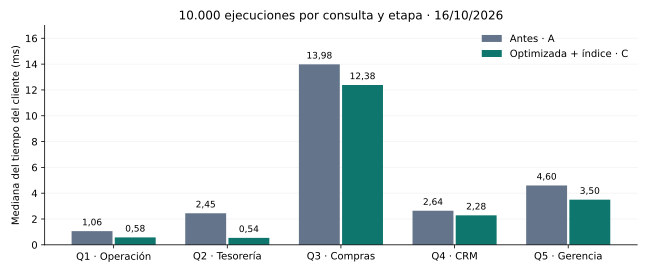

# Informe final — Optimización de consultas de negocio

**Actividad 2.4 / EP2.** Integrantes y sección: _por completar_. Fecha de entrega: _por completar_. Mediciones: 16 de octubre de 2026, 22:06–22:24, hora de Chile.

## 1. Resumen ejecutivo

Se optimizaron cinco consultas de operación, tesorería, compras, CRM y gerencia mediante reescritura del SQL e índices específicos. En lotes de 10.000 ejecuciones, la mediana mejoró entre **11,43 % y 78,00 %**, conservando los resultados. La conciliación obtuvo el mayor beneficio; el ranking de productos, el más limitado. Los tiempos originales ya eran de milisegundos: el valor potencial está en reducir trabajo repetido y acompañar el crecimiento del uso. No se comprobó lentitud en un sistema productivo.

## 2. Contexto y selección de consultas

El laboratorio representa una cadena de comercios: **20 sucursales, 5.000 clientes, 2.000 productos, 20.000 pedidos, 100.000 ítems y 15.000 pagos**. Los conteos y las huellas SHA-256 de todas las tablas coinciden antes y después del experimento ([verificación](evidencias/entorno/dataset_before.json), [integridad del dataset](evidencias/entorno/dataset_equivalence.json)).

| Consulta | Necesidad del negocio y razón para seleccionarla |
|---|---|
| Q1 — Pedidos pendientes | Preparar los últimos 50 pedidos de una sucursal. Se eligió por su posible uso frecuente y el recorrido de pedidos irrelevantes. |
| Q2 — Pagos por método | Conciliar operaciones, monto y ticket medio. Recorre todos los pagos para informar un subconjunto pequeño. |
| Q3 — Productos más vendidos | Priorizar compras y campañas según demanda. Combina tres tablas y es la consulta más costosa del conjunto. |
| Q4 — Clientes activos | Seleccionar una audiencia comercial. Cuenta todos los pedidos coincidentes cuando basta encontrar uno. |
| Q5 — Comparación regional | Comparar sucursales, incluyendo las que no tienen actividad. Su agregación debe preservar esa regla comercial. |

Los datos son sintéticos. Q2 mide **pagos registrados**; Q4 usa pedidos marcados `PAID`; Q5 suma el valor de pedidos no cancelados. Estas métricas no equivalen automáticamente a ingresos bancarios liquidados.

## 3. Objetivo y metodología

Entorno: MySQL **8.0.46** local en WSL2, Intel Core Ultra 7 165H, **22 CPU lógicas visibles**, **15,34 GiB de RAM** y buffer pool de **128 MiB** ([evidencia](evidencias/entorno/)). El almacenamiento físico no quedó confirmado por los discos virtuales de WSL.

Se comparó **A: original**, **B: reescritura sin índice experimental** y **C: SQL de B con índice**. Cada etapa tuvo dos calentamientos, 30 ejecuciones cortas y 10.000 de carga, con pausas de 10 segundos. Los índices se probaron individualmente y se retiraron después; no hubo `ANALYZE TABLE` adicional. Se fijó el fin exclusivo `2026-10-14`, con ventanas de 14 y 90 días.

Python midió ejecución y recepción completa de resultados; `EXPLAIN ANALYZE` se ejecutó aparte. Se muestreó el proceso MySQL cada segundo, excluyendo creación de índices y calentamientos. Coinciden los resultados de los seis lotes por consulta y los hashes de **951 archivos**. La secuencia fija A/B/C y la caché caliente limitan la generalización.

## 4. Resultados comparativos

Se prioriza el lote de 10.000 ejecuciones por su mayor cantidad de observaciones. Mediana: tiempo central; p95: umbral que cubre aproximadamente el 95 % de los tiempos. Se usó rango más próximo para el percentil.

| Consulta | A mediana, ms | B mediana, ms | C mediana, ms | Mejora A→C | p95 A→C, ms |
|---|---:|---:|---:|---:|---:|
| Q1 | 1,061 | 1,083 | 0,576 | 45,65 % | 1,234 → 0,684 |
| Q2 | 2,445 | 2,867 | 0,538 | 78,00 % | 2,990 → 0,647 |
| Q3 | 13,981 | 15,717 | 12,383 | 11,43 % | 17,073 → 15,805 |
| Q4 | 2,643 | 2,485 | 2,284 | 13,58 % | 3,127 → 2,611 |
| Q5 | 4,599 | 5,245 | 3,496 | 23,99 % | 5,862 → 4,171 |

Mejora = `(A − C) / A × 100`, calculada con valores sin redondear. [Datos de carga](evidencias/comparacion_carga.csv) y [pruebas cortas](evidencias/comparacion_micro.csv).



Las pruebas cortas mostraron mejoras A→C de **53,28 %, 80,20 %, 3,72 %, 24,94 % y 34,48 %**, respectivamente. Su magnitud varía respecto a la carga sostenida. En Q3, además, el p95 corto empeoró de **15,789 a 20,131 ms**, por lo que no corresponde declarar una mejora uniforme.

## 5. Análisis de las intervenciones

Los SQL originales completos están en el anexo. Los enlaces siguientes adjuntan las reescrituras y los planes ejecutados de la corrida; las columnas de índices se presentan en su orden exacto.

### 5.1 Q1 — Bandeja de pedidos

**Intervenciones:** quitar `DATE(order_ts)` y usar un rango directo; crear `idx_ep2_q1_store_status_ts(store_id, status, order_ts DESC, order_id DESC)`.

**Evidencia → causa → efecto:** A/B recorren **992 pedidos**, conservan **168** y ordenan para devolver 50: el índice por sucursal deja filtrado residual y sort. C obtiene **50 filas** mediante rango ordenado y elimina el sort; `Sort_rows` cae de **500.000 a 0** por lote. B→C mejora **46,80 %**. Es favorable para una bandeja de uso repetido, aunque el ahorro por apertura es pequeño.

[SQL B](evidencias/Q1/B/carga/Q1_B_query.sql) · [Plan A](evidencias/Q1/A/carga/Q1_A_analyze.txt) · [Plan C](evidencias/Q1/C/carga/Q1_C_analyze.txt).

### 5.2 Q2 — Conciliación de pagos

**Intervenciones:** filtrar directamente por rango de `paid_ts`; crear `idx_ep2_q2_method_ts_amount(method, paid_ts, amount)`.

**Evidencia → causa → efecto:** A/B recorren **15.000 pagos** para encontrar **324** y leer sus montos. C usa `Covering index range scan`: obtiene esas **324 entradas** y sus montos directamente del índice. Los scans completos pasan de **10.000 a 0** por lote. B→C mejora **81,24 %**; la reescritura sola no aceleró. Es la intervención mejor respaldada, preservando las 324 operaciones y el monto de **29.270.761,42**.

[SQL B](evidencias/Q2/B/carga/Q2_B_query.sql) · [Plan A](evidencias/Q2/A/carga/Q2_A_analyze.txt) · [Plan C](evidencias/Q2/C/carga/Q2_C_analyze.txt).

### 5.3 Q3 — Ranking de productos

**Intervenciones:** sustituir `DATE(order_ts)` por rango; crear `idx_ep2_q3_order_ts(order_ts, order_id)`.

**Evidencia → causa → efecto:** A/B escanean **20.000 pedidos**; C accede a **1.574** del período. Sin embargo, permanecen **1.179 pedidos**, **5.844 ítems**, **1.896 grupos**, temporal y sort. El índice mejora la entrada, pero conserva el trabajo de agregación. La carga mejora **11,43 %** frente a A y **21,21 %** frente a B; el p95 corto y el `ANALYZE` aislado no mejoran A→C. Antes de conservarlo, validar estabilidad y frecuencia del reporte.

[SQL B](evidencias/Q3/B/carga/Q3_B_query.sql) · [Plan A](evidencias/Q3/A/carga/Q3_A_analyze.txt) · [Plan C](evidencias/Q3/C/carga/Q3_C_analyze.txt).

### 5.4 Q4 — Audiencia de clientes

**Intervenciones:** cambiar `COUNT(*) > 0` por `EXISTS`; crear `idx_ep2_q4_cust_status_ts(customer_id, status, order_ts)`.

**Evidencia → causa → efecto:** A realiza **335 conteos correlacionados** y revisa **3,77 pedidos por candidato**, en promedio. B usa semijoin para detenerse al encontrar una coincidencia; C usa búsqueda cubierta y baja a **0,821 pedidos por ciclo**. Se evita conteo innecesario y filtrado residual, conservando **118 clientes**. Bajo carga A→B mejora **5,98 %** y B→C **8,09 %**; la prueba corta no confirmó la mejora aislada de B. Persiste el recorrido de **5.000 clientes**.

[SQL B](evidencias/Q4/B/carga/Q4_B_query.sql) · [Plan A](evidencias/Q4/A/carga/Q4_A_analyze.txt) · [Plan C](evidencias/Q4/C/carga/Q4_C_analyze.txt).

### 5.5 Q5 — Comparación regional

**Intervenciones:** usar rango directo manteniendo los filtros en el `ON` del `LEFT JOIN`; crear `idx_ep2_q5_store_ts_status_total(store_id, order_ts, status, total_amount)`.

**Evidencia → causa → efecto:** A/B buscan por sucursal y obtienen fecha, estado y monto desde la tabla; además agrupan y ordenan. C usa acceso cubriente, pero conserva **1.006 entradas por sucursal**, **seis ciclos**, temporal y sort. Los contadores de sesión no disminuyen: la mejora es coherente con cobertura, no demuestra menos filas. C reduce la mediana **23,99 %** frente a A y **33,34 %** frente a B. Su adopción depende del costo del índice ancho.

[SQL B](evidencias/Q5/B/carga/Q5_B_query.sql) · [Plan A](evidencias/Q5/A/carga/Q5_A_analyze.txt) · [Plan C](evidencias/Q5/C/carga/Q5_C_analyze.txt).

## 6. Recursos y costo de las mejoras

CPU acumulada del **proceso MySQL completo** durante cada lote de 10.000 consultas:

| Consulta | CPU A, s | CPU C, s | Reducción observada |
|---|---:|---:|---:|
| Q1 | 7,24 | 2,28 | 68,51 % |
| Q2 | 22,19 | 2,77 | 87,52 % |
| Q3 | 138,72 | 118,71 | 14,42 % |
| Q4 | 23,29 | 15,13 | 35,04 % |
| Q5 | 44,32 | 27,42 | 38,13 % |

La CPU puede incluir otras sesiones. Q2 pasó de **393 a 1.734 consultas/s** en el runner, incluyendo recepción y comprobación de resultados; no representa capacidad concurrente. La memoria residente inicial/final permaneció en **510–512 MiB**, sin ahorro demostrado. Los lotes registraron **0 bytes de lectura física**, compatibles con caché: no se demostró ahorro de lecturas de disco. Las escrituras pueden incluir tareas de fondo.

Crear cada índice tomó **76,7–168,0 ms**; todos se retiraron correctamente. Faltan tamaño individual y costo sobre inserciones/actualizaciones: el tiempo de creación no demuestra que mantenerlos sea gratuito.

## 7. Conclusiones y recomendaciones

**Prioridad:** validar primero Q2 y Q1; después Q5 y Q4. Q3 exige cautela por su variación y la agregación restante. Los porcentajes no deben sumarse ni convertirse en ahorro financiero sin conocer la frecuencia real de cada consulta.

La reescritura **no garantiza acelerar por sí sola**: B empeoró frente a A bajo carga en Q1, Q2, Q3 y Q5. Deben evaluarse conjuntamente tiempos, planes y recursos.

Próximos pasos: **(1)** repetir pruebas intercaladas con mayor volumen y concurrencia; **(2)** medir espacio y costo de escrituras en una copia. Investigar por separado un índice de ciudad/segmento para Q4 y otra agregación para Q3. Antes de combinar índices sobre pedidos, revisar redundancias y costo acumulado: se probaron individualmente.

## 8. Limitaciones y pendientes de entrega

La carga ajena al experimento no fue certificada manualmente. Performance Schema, esperas por índice, locks y estadísticas individuales de espacio quedaron parcialmente inaccesibles por permisos; ausencia de datos no significa ausencia de contención ([cobertura](evidencias/COBERTURA.md)). Los resultados se limitan a datos sintéticos pequeños, caché caliente y ejecución secuencial.

**Por completar:** integrantes/sección, fecha de entrega, capturas exigidas y enlace a la cápsula audiovisual de 2–3 minutos: __________________. Guion sugerido: contexto comercial → intervención → tabla/gráfico y plan → beneficio y costo pendiente. No se da por realizada ninguna de estas evidencias manuales.

## 9. Anexo: SQL original exacto y reproducibilidad

Las siguientes consultas se ejecutaron con los [parámetros congelados](evidencias/entorno/00_parametros.sql). Las versiones B están enlazadas en cada análisis; C ejecuta exactamente B con el índice indicado. El DDL exacto y su limpieza están en `evidencias/Qn/C/ddl.json`.

<details>
<summary>Ver las cinco consultas originales (A)</summary>

```sql
-- Q1
SELECT o.order_id, o.customer_id, o.order_ts, o.total_amount
FROM ep2_orders o
WHERE o.store_id=@store_id AND o.status='CREATED'
  AND DATE(o.order_ts)>=DATE(@long_start_ts)
  AND DATE(o.order_ts)<DATE(@end_ts)
ORDER BY o.order_ts DESC, o.order_id DESC
LIMIT 50;

-- Q2
SELECT p.method, COUNT(*) AS operaciones,
       SUM(p.amount) AS monto_total, AVG(p.amount) AS ticket_medio
FROM ep2_payments p
WHERE p.method=@method
  AND DATE(p.paid_ts)>=DATE(@start_ts)
  AND DATE(p.paid_ts)<DATE(@end_ts)
GROUP BY p.method;

-- Q3
SELECT i.product_id, p.product_name,
       SUM(i.qty) AS unidades
FROM ep2_orders o
JOIN ep2_order_items i ON i.order_id=o.order_id
JOIN ep2_products p ON p.product_id=i.product_id
WHERE DATE(o.order_ts)>=DATE(@start_ts)
  AND DATE(o.order_ts)<DATE(@end_ts)
  AND o.status<>'CANCELLED'
GROUP BY i.product_id, p.product_name
ORDER BY unidades DESC, i.product_id ASC
LIMIT 20;

-- Q4
SELECT c.customer_id, c.full_name, c.city, c.segment
FROM ep2_customers c
WHERE c.city=@city AND c.segment=@segment
  AND (SELECT COUNT(*) FROM ep2_orders o
       WHERE o.customer_id=c.customer_id AND o.status='PAID'
         AND o.order_ts>=@long_start_ts AND o.order_ts<@end_ts)>0
ORDER BY c.customer_id;

-- Q5
SELECT s.store_id, s.store_name,
       COUNT(o.order_id) AS pedidos,
       COALESCE(SUM(o.total_amount),0) AS valor_pedidos
FROM ep2_stores s
LEFT JOIN ep2_orders o
  ON o.store_id=s.store_id
 AND DATE(o.order_ts)>=DATE(@long_start_ts)
 AND DATE(o.order_ts)<DATE(@end_ts)
 AND o.status<>'CANCELLED'
WHERE s.region=@region
GROUP BY s.store_id, s.store_name
ORDER BY valor_pedidos DESC, s.store_id;
```

</details>

Reproducción: [script maestro](automation/run_all_evidence.sh) y [procedimiento completo](docs/EJECUCION_COMPLETA.md). Fuentes numéricas: [comparación de carga](evidencias/comparacion_carga.csv), [microbenchmark](evidencias/comparacion_micro.csv), [configuración de ejecución](evidencias/ejecucion.json) y [manifiesto](evidencias/integridad_sha256.csv).
